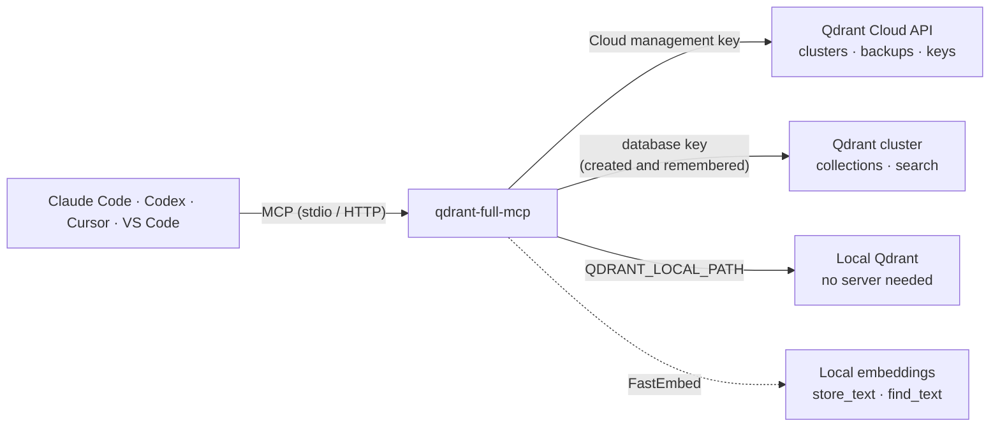

<p align="center">
  
</p>

<p align="center">
  <a href="https://pypi.org/project/qdrant-full-mcp/"></a>
  <a href="https://pypi.org/project/qdrant-full-mcp/"></a>
  <a href="https://github.com/Jeevav62/qdrant-full-mcp/actions/workflows/ci.yml"></a>
  <a href="https://github.com/Jeevav62/qdrant-full-mcp/blob/main/LICENSE"></a>
  <a href="https://modelcontextprotocol.io"></a>
</p>

<p align="center">
  <b>The complete Qdrant MCP server.</b> Manage Qdrant Cloud and your vector data from Claude Code, Codex, Cursor,
  VS Code or any MCP client, in plain English.
</p>

<p align="center">
  <a href="#quick-start">Quick start</a> ·
  <a href="#features">Features</a> ·
  <a href="#how-it-works">How it works</a> ·
  <a href="#compared-with-the-official-qdrant-mcp-server">Comparison</a> ·
  <a href="#faq">FAQ</a>
</p>

---

**qdrant-full-mcp** is an open-source [Model Context Protocol](https://modelcontextprotocol.io) (MCP) server for the
[Qdrant](https://qdrant.tech) vector database. It gives AI coding agents 43 tools to run Qdrant end to end:
**Qdrant Cloud management** (clusters, backups, API keys), **data operations** (collections, upserts, dense, sparse
and hybrid search, payload indexes) and **plain-text memory** with local embeddings. It does everything the official
`mcp-server-qdrant` does, and adds infrastructure management and safety rails on top.

> **Zero to a working RAG store in one chat**
> *"Create a free Qdrant cluster in Mumbai, store these notes, then find what we said about refunds."*
> The agent creates the cluster, creates a database key, asks once whether to remember it, stores your text and
> searches it. No console, no config edits, no restart.

## Features

| | |
|---|---|
| ☁️ **Qdrant Cloud management** | Create, scale, suspend, restart and delete clusters; list regions, packages and prices |
| 🔑 **Keys that just work** | The agent creates database keys and remembers them, so data tools work immediately |
| 💾 **Backups and restores** | On-demand backups, cron schedules with retention, restore in place or to a new cluster |
| 🗂️ **Collections and indexes** | Single, named and sparse vectors; keyword, integer, text, geo and other payload indexes |
| 🔎 **Search** | Dense, sparse and **hybrid** search (RRF or DBSF fusion), filters, scroll, counts |
| 🧠 **Plain-text memory** | `store_text` / `find_text` with local FastEmbed embeddings, compatible with the official server |
| 💻 **No server needed to start** | `QDRANT_LOCAL_PATH` runs Qdrant inside the MCP server; switch to Cloud by changing one setting |
| 🛡️ **Safe by default** | Every change is a dry run until confirmed; deletes need the exact name; read-only mode |
| 🌐 **Runs anywhere** | stdio, SSE and streamable HTTP transports, Docker image, Claude Code plugin |

## Quick start

**1. Get a key.** In the [Qdrant Cloud console](https://cloud.qdrant.io): *Access Management* → *Cloud Management
Keys* → create one. That is the only setting you need; the account is detected automatically.

**2. Download once.** Requires [uv](https://docs.astral.sh/uv/getting-started/installation/). The first run fetches
dependencies (about 40 seconds, then cached), which is longer than some clients wait for a server to start:

```bash
uvx qdrant-full-mcp --help
```

<sub>On a slow connection: <code>UV_HTTP_TIMEOUT=180 uvx qdrant-full-mcp --help</code> (PowerShell:
<code>$env:UV_HTTP_TIMEOUT=180; uvx qdrant-full-mcp --help</code>).</sub>

**3. Add it to your AI client.**

### Claude Code

```bash
claude mcp add qdrant -e QDRANT_CLOUD_API_KEY=your-management-key -- uvx qdrant-full-mcp
```

Check with `claude mcp list` or `/mcp`, then ask: *"List my Qdrant Cloud clusters."*

<details>
<summary>Install as a Claude Code plugin (adds a skill with the safe workflows)</summary>

```
/plugin marketplace add Jeevav62/qdrant-full-mcp
/plugin install qdrant@qdrant-full-mcp
```

Set `QDRANT_CLOUD_API_KEY` in your environment before starting Claude Code. To keep the key out of Claude's config
with the plain install, use `-e 'QDRANT_CLOUD_API_KEY=${QDRANT_CLOUD_API_KEY}'`.
</details>

### OpenAI Codex

```bash
codex mcp add qdrant --env QDRANT_CLOUD_API_KEY=your-management-key -- uvx qdrant-full-mcp
```

<details>
<summary>Or edit <code>~/.codex/config.toml</code></summary>

```toml
[mcp_servers.qdrant]
command = "uvx"
args = ["qdrant-full-mcp"]
startup_timeout_sec = 60

[mcp_servers.qdrant.env]
QDRANT_CLOUD_API_KEY = "your-management-key"
```

Verify with `codex mcp list`.
</details>

<details>
<summary>Cursor, Claude Desktop, Windsurf and other JSON-config clients</summary>

```json
{
  "mcpServers": {
    "qdrant": {
      "command": "uvx",
      "args": ["qdrant-full-mcp"],
      "env": { "QDRANT_CLOUD_API_KEY": "your-management-key" }
    }
  }
}
```

Cursor: `~/.cursor/mcp.json`. Claude Desktop: `claude_desktop_config.json`.
</details>

<details>
<summary>VS Code (<code>.vscode/mcp.json</code>)</summary>

```json
{
  "servers": {
    "qdrant": {
      "type": "stdio",
      "command": "uvx",
      "args": ["qdrant-full-mcp"],
      "env": { "QDRANT_CLOUD_API_KEY": "your-management-key" }
    }
  }
}
```
</details>

<details>
<summary>From a local clone</summary>

```bash
git clone https://github.com/Jeevav62/qdrant-full-mcp
claude mcp add qdrant -e QDRANT_CLOUD_API_KEY=your-management-key -- uv run --project ./qdrant-full-mcp qdrant-full-mcp
```
</details>

## How it works



- **Two credentials, handled for you.** The Cloud management key runs infrastructure; Qdrant does not let it read
  data. When the agent creates a database key with `create_database_api_key`, the server remembers it for that
  cluster, so data tools work at once. The agent asks whether to **save it on this machine**; if you agree, every
  later session in any MCP client uses it (`%APPDATA%\qdrant-full-mcp\keys.json` on Windows,
  `~/.config/qdrant-full-mcp/keys.json` elsewhere, file mode 600, never printed). Keys you set yourself
  (`QDRANT_API_KEY_<CLUSTER_ID>`, `QDRANT_API_KEY`) always take priority.
- **Endpoints are looked up for you.** Pass `cluster_id` to any data tool. For self-hosted Qdrant, set `QDRANT_URL`
  and `QDRANT_API_KEY` instead.

## Use cases

- **Build a RAG backend from chat:** create a cluster, a collection with dense and sparse vectors, a payload index,
  and run hybrid search to test retrieval quality.
- **Give your agent long-term memory:** set `COLLECTION_NAME=memory` and say *"remember that…"* / *"what do we know
  about…"*.
- **Operate production safely:** scale clusters, schedule backups, rotate keys, and inspect collections with dry runs
  and exact-name confirmations.
- **Learn vector search locally:** `QDRANT_LOCAL_PATH=./qdrant-data`, no account and no server.

## Plain-text memory (store and find)

`store_text` and `find_text` embed text on your machine with [FastEmbed](https://github.com/qdrant/fastembed), the same
approach as the official server, so you never handle vectors. For an agent memory with one default collection:

```bash
claude mcp add qdrant -e QDRANT_URL=https://your-cluster:6333 -e QDRANT_API_KEY=db-key -e COLLECTION_NAME=memory -- uvx qdrant-full-mcp
```

- Stores into `COLLECTION_NAME` happen in one step and create the collection on first use; other collections keep
  the dry-run-then-confirm flow.
- Default model `sentence-transformers/all-MiniLM-L6-v2` (384 dimensions, about 90 MB on first use); change it with
  `EMBEDDING_MODEL`.
- Same layout as the official server (named vector `fast-<model>`, payload `{"document", "metadata"}`), so both
  servers can share a collection.
- `TOOL_STORE_DESCRIPTION` / `TOOL_FIND_DESCRIPTION` customize the tools (for example, a code-snippet library);
  `QDRANT_SEARCH_LIMIT` sets the default result count.
- On Qdrant Cloud, a field you filter on needs a payload index; if it is missing, the error tells the agent the exact
  `create_payload_index` call that fixes it.

## Run as an HTTP server or in Docker

```bash
qdrant-full-mcp --transport streamable-http --port 8000   # http://127.0.0.1:8000/mcp
qdrant-full-mcp --transport sse                           # older SSE clients
```

```bash
docker build -t qdrant-full-mcp .
docker run -p 127.0.0.1:8000:8000 -e QDRANT_URL=https://your-cluster:6333 -e QDRANT_API_KEY=db-key -e COLLECTION_NAME=memory qdrant-full-mcp
```

The server binds to `127.0.0.1` by default and has no built-in authentication while holding your Qdrant keys. If you
expose it (`--host 0.0.0.0`), put an authenticating proxy in front. The Docker image includes the default embedding
model and runs as a non-root user.

## Example prompts

- "List my Qdrant Cloud clusters." · "Show the available AWS regions and prices."
- "Create a Qdrant cluster in AWS London with the smallest paid package." *(shows the price, waits for approval)*
- "Scale cluster X to 3 nodes." · "Suspend cluster X."
- "Back up cluster X every day at 3am and keep backups for 14 days."
- "Restore backup Y into a new cluster called `restored-1`."
- "Make a database key for cluster X and save it on this machine."
- "Create a collection `docs` with a 768-dim dense vector and a sparse vector for hybrid search."
- "Add a keyword index on `tenant_id` in `docs`." · "How many points are in `docs`?"
- "Store these three FAQ answers in `faq`." · "Search `faq` for how refunds work."
- "Delete cluster `old-test`." *(you confirm the exact name)*

## Compared with the official Qdrant MCP server

| Capability | official `mcp-server-qdrant` | `qdrant-full-mcp` |
|---|:---:|:---:|
| Store and find text with built-in embeddings | ✅ | ✅ |
| Default collection (`COLLECTION_NAME`), one-step store | ✅ | ✅ |
| Local mode without a server (`QDRANT_LOCAL_PATH`) | ✅ store/find | ✅ all data and text tools |
| Custom tool descriptions, default search limit | ✅ | ✅ same variable names |
| stdio, SSE, streamable HTTP, Docker | ✅ | ✅ |
| Qdrant Cloud cluster management | | ✅ |
| Backups, schedules and restores | | ✅ |
| Database API keys created and remembered by the agent | | ✅ |
| Named and sparse vectors, payload indexes | | ✅ |
| Dense, sparse and hybrid (RRF, DBSF) search with your own vectors | | ✅ |
| Dry run and exact-name confirmation on changes | read-only flag | ✅ |

Both servers use the same collection layout for text, so you can switch or run them side by side.

## Tools

<details>
<summary><b>All 43 tools</b></summary>

**Cloud, read-only:** `list_accounts`, `list_clusters`, `get_cluster`, `list_cloud_providers`, `list_regions`,
`list_packages`, `list_releases`, `list_backups`, `list_backup_schedules`, `list_database_api_keys`, `list_members`,
`list_remembered_keys`

**Cloud, changes things:** `create_cluster`, `update_cluster`, `delete_cluster`, `restart_cluster`, `suspend_cluster`,
`unsuspend_cluster`, `create_backup`, `delete_backup`, `restore_backup_to_new_cluster`, `restore_backup` (in place,
overwrites), `create_backup_schedule`, `delete_backup_schedule`, `create_database_api_key`, `delete_database_api_key`,
`forget_database_api_key`

**Data, read-only:** `list_collections`, `get_collection`, `list_payload_indexes`, `count_points`, `get_points`,
`scroll_points`, `query_points` (dense or sparse), `hybrid_query_points` (dense + sparse, RRF or DBSF)

**Data, changes things:** `create_collection` (single, named and sparse vectors), `delete_collection`,
`create_payload_index`, `delete_payload_index`, `upsert_points`, `delete_points`

**Text:** `store_text`, `find_text`
</details>

## Safety and security

- Every mutating tool is a **dry run unless `confirm=true`**, and tool descriptions tell the agent to get your approval.
- Irreversible actions need the exact name: `delete_cluster` and `restore_backup` (`confirm_cluster_name`),
  `delete_collection` (`confirm_collection_name`).
- `QDRANT_MCP_READ_ONLY=1` (or `QDRANT_READ_ONLY=1`) blocks every write; `QDRANT_MCP_MODULES` loads only the modules
  you list (`cloud`, `data`, `text`).
- Keys come from your environment or the opt-in key file, are never logged or echoed, and saved keys are removed when
  the key or cluster is deleted. `QDRANT_MCP_KEY_FILE=off` never writes keys to disk.
- Ids and paths are validated before any request. Prefer least-privilege keys.

## Configuration

<details>
<summary><b>All environment variables</b></summary>

| Variable | Used by | Notes |
|---|---|---|
| `QDRANT_CLOUD_API_KEY` | cloud tools | the only required variable |
| `QDRANT_CLOUD_ACCOUNT_ID` | cloud tools | auto-detected when the key has one account |
| `QDRANT_API_KEY` | data tools | database key fallback (optional for unauthenticated local Qdrant) |
| `QDRANT_API_KEY_<CLUSTER_ID>` | data tools | per-cluster key; wins over remembered keys and `QDRANT_API_KEY` |
| `QDRANT_MCP_KEY_FILE` | data tools | where saved database keys go; `off` disables the key file |
| `QDRANT_URL` | data tools | self-hosted or direct endpoint, e.g. `http://localhost:6333` |
| `QDRANT_LOCAL_PATH` | data tools | run without a server: a folder or `:memory:` (instead of `QDRANT_URL`) |
| `COLLECTION_NAME` | text tools | default collection; stores into it skip the dry run |
| `EMBEDDING_MODEL` | text tools | FastEmbed model, default `sentence-transformers/all-MiniLM-L6-v2` |
| `QDRANT_SEARCH_LIMIT` | text tools | default `find_text` result count, 1..100 (default 5) |
| `TOOL_STORE_DESCRIPTION`, `TOOL_FIND_DESCRIPTION` | text tools | replace the tool descriptions |
| `QDRANT_MCP_MODULES` | server | `cloud,data,text` (default) |
| `QDRANT_MCP_READ_ONLY` | server | `1` blocks writes (`QDRANT_READ_ONLY` also works) |
| `QDRANT_MCP_TRANSPORT` | server | `stdio` (default), `sse` or `streamable-http`; same as `--transport` |
| `FASTMCP_SERVER_HOST`, `FASTMCP_SERVER_PORT` | server | HTTP bind address and port (`FASTMCP_HOST`/`FASTMCP_PORT` also work) |
| `QDRANT_CLOUD_API_URL` | cloud tools | default `https://api.cloud.qdrant.io` |

See [`.env.example`](https://github.com/Jeevav62/qdrant-full-mcp/blob/main/.env.example). Never commit real values.
</details>

## FAQ

**What is qdrant-full-mcp?**
An open-source MCP server that lets AI agents such as Claude Code and OpenAI Codex manage Qdrant Cloud (clusters,
backups, API keys) and work with Qdrant data (collections, vector and hybrid search, text memory) through natural
language.

**How do I connect Claude Code to Qdrant?**
Run `claude mcp add qdrant -e QDRANT_CLOUD_API_KEY=your-key -- uvx qdrant-full-mcp`, then ask Claude to list your
clusters. For Codex, use `codex mcp add qdrant --env QDRANT_CLOUD_API_KEY=your-key -- uvx qdrant-full-mcp`.

**How is it different from the official mcp-server-qdrant?**
The official server is a semantic memory with two tools (store and find). qdrant-full-mcp includes the same store and
find behaviour and collection layout, and adds Qdrant Cloud management, backups, database keys, named and sparse
vectors, payload indexes, hybrid search and confirmation-based safety. See the [comparison](#compared-with-the-official-qdrant-mcp-server).

**Can it create a free Qdrant Cloud cluster?**
Yes. Ask *"create a free cluster in &lt;region&gt;"*. Qdrant allows one free cluster per account; a second request
returns a clear quota error.

**Do I need to generate embeddings myself?**
No for text: `store_text` and `find_text` embed locally with FastEmbed. Yes for the vector tools (`upsert_points`,
`query_points`, `hybrid_query_points`), which take your own dense or sparse vectors.

**Does it support hybrid search?**
Yes. `hybrid_query_points` combines a dense and a sparse query with reciprocal rank fusion (RRF) or
distribution-based score fusion (DBSF).

**Can I use it without Qdrant Cloud?**
Yes. Point `QDRANT_URL` at a self-hosted Qdrant, or set `QDRANT_LOCAL_PATH` to run Qdrant inside the server with no
installation.

**Is it safe to let an AI agent manage my database?**
Changes are dry runs until confirmed, deletes and in-place restores require the exact resource name, and
`QDRANT_MCP_READ_ONLY=1` blocks all writes. Your MCP client also asks before running tools.

**Is this an official Qdrant product?**
No. It is an independent, MIT-licensed community project and is not affiliated with or endorsed by Qdrant.

## Status

Verified live on Qdrant Cloud: cluster create, update, restart, suspend and unsuspend; database API keys including the
remembered-key flow across server restarts; collections, named and sparse vectors, payload indexes, upserts, dense,
sparse and hybrid search, deletes; `store_text` / `find_text` and filters. Also verified through the MCP protocol over
stdio and streamable HTTP, in local mode, and in Docker.

Not yet verified live: backups, backup schedules, restores and cluster delete (free-tier clusters do not support
backups). Reports from paid-cluster users are welcome.

**Roadmap:** snapshots, collection aliases, quantization and HNSW options, payload updates without re-upserting, a
`copy_collection` tool. **Out of scope:** members, roles and billing; hybrid-cloud environments.

## Contributing

Issues and pull requests are welcome.

```bash
git clone https://github.com/Jeevav62/qdrant-full-mcp && cd qdrant-full-mcp
pip install -e ".[dev]"
pytest
```

The Cloud REST gateway expects snake_case query parameters (for example `page_size`) and accepts camelCase JSON
bodies; schemas live in [qdrant-cloud-public-api](https://github.com/qdrant/qdrant-cloud-public-api).

## License

[MIT](https://github.com/Jeevav62/qdrant-full-mcp/blob/main/LICENSE). Unofficial community project, not affiliated
with or endorsed by Qdrant. "Qdrant" is a trademark of its owner.
